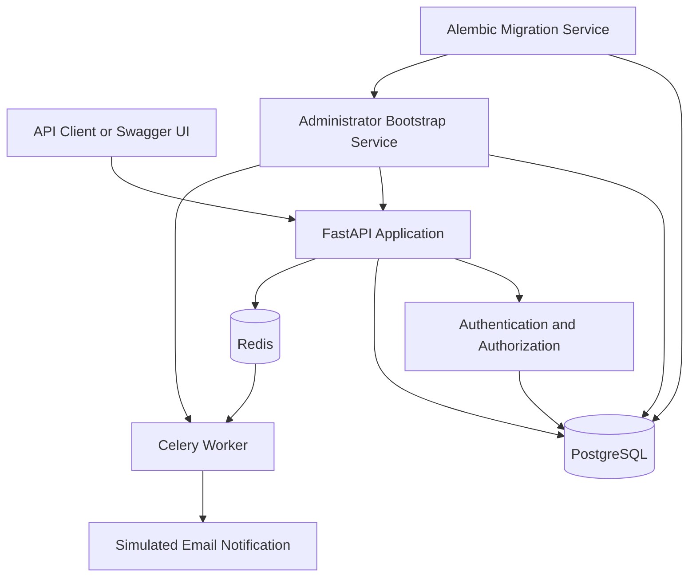
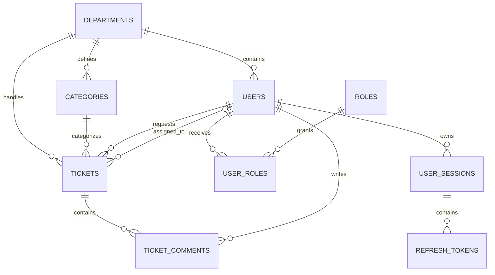
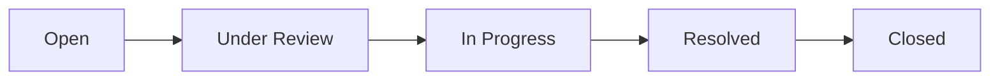

# IT Helpdesk and Ticketing System

A backend REST API for managing internal IT support requests, developed as part of a 16-module FastAPI backend engineering training program.

The system enables employees to submit support tickets, administrators to review and assign tickets, and support agents to investigate and resolve technical issues. It implements secure authentication, role-based authorization, persistent database storage, caching, background task processing, observability, automated testing and containerized deployment.

## 1. Features

- REST API with `/api/v1` versioning
- JWT access token authentication
- Refresh token rotation and reuse detection
- Session-based authentication and logout
- Argon2id password hashing
- Role-based access control
- Department and category management
- User and support agent management
- Ticket creation, assignment, updating and soft deletion
- Public and internal ticket comments
- Pagination, filtering and searching
- Redis caching and cache invalidation
- Redis-based rate limiting
- Celery background notification tasks
- Role-scoped ticket dashboard
- Structured JSON logging and request correlation
- Prometheus metrics
- Health and readiness endpoints
- PostgreSQL database constraints and performance indexes
- Automated database migrations
- Automatic initial administrator provisioning
- Docker Compose deployment
- Automated testing and CI quality checks

## 2. Technology Stack

| Technology | Purpose |
|---|---|
| Python 3.12 | Application programming language |
| FastAPI | REST API framework |
| Pydantic | Request validation and response serialization |
| PostgreSQL 16 | Persistent relational database |
| SQLAlchemy | ORM and database access |
| Psycopg | PostgreSQL driver |
| Alembic | Database schema migrations |
| Redis 7 | Caching, rate limiting and message broker |
| Celery | Asynchronous background task processing |
| PyJWT | JWT encoding and validation |
| pwdlib / Argon2id | Password hashing |
| Structlog | Structured application logging |
| Prometheus Client | Application metrics |
| Gunicorn / Uvicorn | Application serving |
| Pytest / HTTPX | Automated testing |
| Locust | Load testing |
| Ruff | Code linting and formatting |
| pip-audit | Dependency vulnerability scanning |
| Gitleaks | Secret detection |
| Docker / Docker Compose | Containerization and orchestration |
| GitHub Actions | Continuous integration |

## 3. System Architecture



PostgreSQL is the primary source of truth for application data.

Redis stores temporary cached responses and rate-limit counters and acts as the Celery message broker.

Celery processes notification tasks independently of the API application.

The migration and bootstrap services initialize the database before the application and worker start.

## 4. Project Structure

```text
.
├── alembic/
├── api/
├── core/
├── database/
├── docs/
├── models/
├── routes/
├── schema/
├── scripts/
├── services/
├── tasks/
├── tests/
├── .github/
├── .dockerignore
├── .env.example
├── .gitignore
├── alembic.ini
├── celery_app.py
├── docker-compose.yml
├── Dockerfile
├── main.py
├── pytest.ini
├── requirements.txt
├── requirements-dev.txt
├── ruff.toml
└── README.md
```

| Directory | Responsibility |
|---|---|
| `api/` | API organization and versioning |
| `core/` | Configuration, security, dependencies and shared infrastructure |
| `database/` | Database and Redis connections |
| `models/` | SQLAlchemy database models |
| `schema/` | Pydantic request and response schemas |
| `routes/` | API endpoint implementations |
| `services/` | Application service logic |
| `tasks/` | Celery background tasks |
| `alembic/` | Database migration history |
| `scripts/` | Initialization, maintenance and performance utilities |
| `tests/` | Automated tests |
| `docs/` | Technical reports and implementation documentation |

## 5. Database Design

The system contains nine primary application entities.

| Entity | Responsibility |
|---|---|
| Departments | Organizational departments |
| Users | Employee and administrator accounts |
| Roles | Administrator and agent role definitions |
| User Roles | User-to-role associations |
| Categories | Department-specific support categories |
| Tickets | IT support requests |
| Ticket Comments | Public and internal ticket conversations |
| User Sessions | Authentication sessions |
| Refresh Tokens | Refresh token rotation and revocation records |

### Entity Relationships



Database integrity is enforced through primary keys, foreign keys, unique constraints, check constraints and a composite foreign key ensuring ticket-category department consistency.

Database schema changes are managed through Alembic.

Latest migration revision:

```text
269eebd9bb24
```

The complete 12-revision migration history has been successfully executed against an empty PostgreSQL database.

## 6. Authentication

The application uses OAuth2 password-form login and JWT bearer access tokens.

### Authentication Flow

1. A user submits their email and password.
2. The application verifies the stored Argon2id password hash.
3. A user session is created.
4. An access token and an opaque refresh token are issued.
5. Protected endpoints validate the access token, user status and session.
6. Refresh requests rotate refresh tokens.
7. Refresh token reuse revokes the associated session.
8. Logout revokes the current session.
9. Password changes invalidate previously issued authentication credentials.

Refresh tokens are stored as hashes rather than plaintext values.

Access tokens contain the following application claims:

| Claim | Purpose |
|---|---|
| `sub` | User identifier |
| `exp` | Token expiration |
| `ver` | User token version |
| `sid` | Session identifier |

Default example configuration:

- Access token lifetime: 15 minutes
- Refresh token lifetime: 7 days
- Session lifetime: 30 days

Refresh token expiration cannot exceed the associated session lifetime.

## 7. Authorization and Permissions

The application supports three effective user roles.

### Administrator

Administrators manage users, departments, categories, agents and ticket assignments. They can access all active tickets and manage operational ticket fields.

### Agent

Agents can access tickets assigned to them and tickets they personally requested. They can update the status of tickets assigned to them and create internal comments on accessible tickets.

### Requester

Requesters can create support tickets, view their own tickets and participate in public ticket conversations. They cannot access other users' tickets or internal comments.

Requesters are represented by the absence of administrator and agent role assignments.

### Permission Matrix

| Operation | Administrator | Agent | Requester |
|---|---|---|---|
| Create ticket | Yes | Yes | Yes |
| View all active tickets | Yes | No | No |
| View own ticket | Yes | Yes | Yes |
| View assigned ticket | Yes | Yes | Not applicable |
| Assign or reassign tickets | Yes | No | No |
| Change operational priority | Yes | No | No |
| Update ticket status | Yes | Assigned tickets | No |
| Edit requester-owned fields | Own eligible tickets | Own eligible tickets | Own eligible tickets |
| Soft-delete ticket | Yes | Own eligible tickets | Own eligible tickets |
| Create public comments | Accessible tickets | Accessible tickets | Own tickets |
| Create internal comments | Accessible tickets | Accessible tickets | No |
| View internal comments | Accessible tickets | Accessible tickets | No |
| Manage users | Yes | No | No |
| Manage departments | Yes | No | No |
| Manage categories | Yes | No | No |
| View personal dashboard | Yes | Yes | Yes |

Eligible requester-owned tickets must be open and unassigned.

Administrator permissions take precedence when a user has both administrator and agent roles.

Ticket assignment requires an active agent belonging to the ticket's department. A requester cannot be assigned to their own ticket.

Inaccessible ticket resources return HTTP 404 to avoid unnecessarily revealing their existence.

## 8. Ticket Lifecycle

The normal ticket workflow is:



| Status | Meaning |
|---|---|
| `open` | Newly submitted support request |
| `under_review` | Administrator is reviewing the ticket |
| `in_progress` | Issue is being investigated or handled |
| `resolved` | Issue has been resolved |
| `closed` | Ticket has been finalized |

Administrators may return tickets to earlier statuses when operationally necessary. The diagram represents the normal workflow rather than a strictly enforced finite-state machine.

Supported priorities:

- `low`
- `medium`
- `high`
- `urgent`

Tickets maintain both requested priority and operational priority.

Ticket deletion is implemented as soft deletion. Deleted tickets are excluded from normal ticket queries and dashboard statistics.

## 9. API Reference

The business API is versioned under `/api/v1`.

### Authentication

| Method | Endpoint |
|---|---|
| POST | `/api/v1/auth/login` |
| POST | `/api/v1/auth/refresh` |
| POST | `/api/v1/auth/logout` |

### Tickets

| Method | Endpoint |
|---|---|
| GET | `/api/v1/tickets` |
| POST | `/api/v1/tickets` |
| GET | `/api/v1/tickets/{ticket_id}` |
| PATCH | `/api/v1/tickets/{ticket_id}` |
| DELETE | `/api/v1/tickets/{ticket_id}` |

Ticket listing supports pagination, searching and filtering by status, priority, category and department.

Administrator-specific assignment filtering is also available.

### Ticket Comments

| Method | Endpoint |
|---|---|
| POST | `/api/v1/tickets/{ticket_id}/comments` |
| GET | `/api/v1/tickets/{ticket_id}/comments` |

### Categories

| Method | Endpoint |
|---|---|
| GET | `/api/v1/categories` |
| POST | `/api/v1/categories` |
| PATCH | `/api/v1/categories/{category_id}` |
| DELETE | `/api/v1/categories/{category_id}` |

Category deletion deactivates a category rather than physically removing it.

### Users and Roles

| Method | Endpoint |
|---|---|
| POST | `/api/v1/users` |
| GET | `/api/v1/users` |
| GET | `/api/v1/users/{user_id}` |
| PATCH | `/api/v1/users/{user_id}/status` |
| PATCH | `/api/v1/users/me/password` |
| POST | `/api/v1/admin/users/{user_id}/roles` |

### Departments and Agents

| Method | Endpoint |
|---|---|
| GET | `/api/v1/departments` |
| POST | `/api/v1/departments` |
| GET | `/api/v1/departments/{department_id}` |
| PATCH | `/api/v1/departments/{department_id}` |
| GET | `/api/v1/agents` |
| GET | `/api/v1/departments/{department_id}/agents` |

### Dashboard

| Method | Endpoint |
|---|---|
| GET | `/api/v1/dashboard/me` |

### Infrastructure

| Method | Endpoint | Purpose |
|---|---|---|
| GET | `/health` | Application liveness |
| GET | `/ready` | Database and Redis readiness |
| GET | `/metrics` | Prometheus metrics |
| GET | `/docs` | Swagger UI |
| GET | `/redoc` | ReDoc documentation |
| GET | `/openapi.json` | OpenAPI schema |

Infrastructure and documentation endpoints are not versioned.

## 10. API Response Format

Most successful business responses use a consistent response envelope.

```json
{
  "success": true,
  "data": {
    "id": 1
  }
}
```

Paginated responses contain items and pagination metadata.

```json
{
  "success": true,
  "data": {
    "items": [],
    "total": 0,
    "page": 1,
    "limit": 10,
    "total_pages": 0
  }
}
```

Error responses use a structured error envelope.

```json
{
  "success": false,
  "error": {
    "code": "ERROR_CODE",
    "message": "Error description"
  },
  "request_id": "request-identifier"
}
```

Validation errors may include additional details.

Login and refresh responses intentionally use the OAuth2-compatible token response format without the standard success envelope.

Successful ticket deletion returns HTTP 204 without a response body. Infrastructure endpoints use their own response formats.

## 11. Installation Using Docker

### Prerequisites

- Git
- Docker Engine
- Docker Compose v2

A local Python environment, PostgreSQL installation and Redis installation are not required for Docker deployment.

### Clone the Repository

```bash
git clone https://github.com/Deepanshu6719/Deepanshu-IT-HelpDesk-and-Ticketing-Training.git
cd Deepanshu-IT-HelpDesk-and-Ticketing-Training
```

### Configure Environment Variables

```bash
cp .env.example .env
chmod 600 .env
```

Generate strong random secrets using a trusted password manager or a cryptographically secure generator.

For example, if Python 3 is available:

```bash
python3 -c "import secrets; print(secrets.token_urlsafe(32))"
python3 -c "import secrets; print(secrets.token_hex(32))"
```

Edit `.env` and replace the placeholder database password and application secret key.

For a fresh database, also configure:

```dotenv
BOOTSTRAP_ADMIN_EMAIL=admin@example.com
BOOTSTRAP_ADMIN_PASSWORD=
```

Set a strong, unique administrator password containing 12–128 characters. Do not use the empty example value.

### Environment Variable Precedence

Docker Compose gives exported shell variables precedence over values in `.env` during Compose interpolation.

Before starting an independent deployment, ensure that unrelated exported variables cannot override its intended configuration.

```bash
unset DB_USER DB_PASSWORD DB_NAME DB_HOST DB_PORT
unset SECRET_KEY APP_PORT
```

Validate the configuration:

```bash
docker compose config --quiet
```

All database-consuming services use the same interpolated database credentials as PostgreSQL.

Changing database credentials in `.env` does not automatically change the credentials of an already initialized PostgreSQL volume.

### Start the Application

```bash
docker compose up -d --build
```

This starts the complete application stack:

| Service | Responsibility |
|---|---|
| `db` | PostgreSQL database |
| `redis` | Redis caching and message broker |
| `migrate` | Execute Alembic migrations |
| `bootstrap` | Initialize roles and the first administrator |
| `app` | FastAPI application |
| `worker` | Celery background worker |

The migration and bootstrap services are one-shot services. An exit code of 0 indicates successful completion.

### Verify Deployment

```bash
docker compose ps -a
docker compose logs migrate bootstrap
```

```bash
curl -fsS http://127.0.0.1:8001/health
curl -fsS http://127.0.0.1:8001/ready
```

Expected readiness response:

```json
{
  "status": "ready",
  "checks": {
    "postgres": "up",
    "redis": "up"
  }
}
```

The default application port is `8001`.

Open Swagger UI:

http://127.0.0.1:8001/docs

### Stop the Application

```bash
docker compose down
```

PostgreSQL and Redis named volumes are retained.

Do not use `docker compose down --volumes` against an environment containing important data unless permanent data deletion is explicitly intended.

## 12. Administrator Bootstrap

On a fresh database, the bootstrap service:

1. Acquires a PostgreSQL transaction-level advisory lock.
2. Creates missing administrator and agent roles.
3. Checks whether an active administrator already exists.
4. Creates the initial IT department when required.
5. Validates the configured administrator credentials.
6. Hashes the initial administrator password.
7. Creates the administrator with administrator and agent roles.
8. Commits the initialization transaction.

If an active administrator already exists, the bootstrap service skips administrator creation.

Repeated and concurrent initialization against an existing administrator has been verified without duplicate records.

Bootstrap does not silently promote an existing account with the configured email.

### Bootstrap Credential Cleanup

After successful initialization:

- Retain the administrator login password in an appropriate password manager.
- Remove bootstrap credentials from `.env`.
- Recreate the containers so their environment configurations no longer contain those credentials.

```bash
docker compose up -d --force-recreate
```

The initialized administrator can continue authenticating without bootstrap environment variables.

Removing bootstrap environment variables does not rotate the existing administrator password.

## 13. Local Development

For development without Docker, install Python 3.12, PostgreSQL and Redis.

Create a virtual environment:

```bash
python3.12 -m venv .venv
source .venv/bin/activate
```

Install dependencies:

```bash
python -m pip install -r requirements-dev.txt
```

Configure `.env` with the appropriate local PostgreSQL and Redis connection settings.

Create the PostgreSQL database and database user before running migrations.

```bash
alembic upgrade head
```

Initialize the first administrator interactively:

```bash
python -m scripts.init_db
```

Start the API:

```bash
uvicorn main:app --reload
```

Start a Celery worker in another terminal with the virtual environment activated:

```bash
celery -A celery_app.celery_app worker --loglevel=info
```

Verify database migration status:

```bash
alembic current
alembic heads
alembic check
```

## 14. Caching and Rate Limiting

Redis is used for category response caching and ticket dashboard caching.

Category cache entries expire automatically and are invalidated when category data changes.

Dashboard cache entries are scoped to the authenticated user's effective permissions and user identifier.

Dashboard statistics include:

- Total visible tickets
- Counts by status
- Counts by priority
- Assigned ticket count
- Unassigned ticket count

Dashboard cache entries have a 60-second TTL and use generation-based invalidation when relevant ticket or user authorization data changes.

Redis failures are handled according to the responsibility of each feature. Dashboard caching can fall back to PostgreSQL when Redis caching is unavailable.

### Rate Limiting

Authentication endpoints use Redis-backed fixed-window rate limiting.

| Endpoint | Limit |
|---|---|
| Login | 5 requests per 60 seconds per client IP |
| Refresh | 20 requests per 60 seconds per client IP |

Exceeding the configured limit returns HTTP 429.

Rate-limit counters are updated atomically through a Redis Lua script.

## 15. Background Tasks

Celery processes ticket notification tasks using Redis as its message broker.

Notification tasks are triggered when:

- A new ticket is created.
- A ticket is assigned or reassigned to an agent.

Creation notifications target the requester and active administrators. Assignment notifications target the assigned agent and requester.

HTTP request identifiers are propagated to Celery task logs for request-to-task correlation.

Actual Celery background execution is implemented and verified. External email delivery is simulated; no production email provider is configured.

## 16. Security

Implemented security controls include:

- Argon2id password hashing
- JWT signature and expiration validation
- Session revocation
- Refresh token rotation and reuse detection
- Account activation checks
- Token invalidation after password changes
- Role-based authorization
- Object-level authorization
- Mass assignment protection
- Strict request validation
- Authentication rate limiting
- Explicit CORS origin configuration
- Security response headers
- Secret exclusion from Git and Docker build context
- Non-root Python application containers
- Loopback-only default application port binding
- Dependency vulnerability scanning
- Secret scanning

HSTS is configurable and disabled in the default local HTTP environment.

Production deployments require additional infrastructure security controls, including HTTPS, appropriate network restrictions and managed secrets.

See [Security Audit](docs/security-audit.md).

## 17. Observability

The application produces structured JSON logs containing relevant request metadata, including:

- Request identifier
- HTTP method
- Request path
- Response status
- Request duration
- Authenticated user identifier when available

The `X-Request-ID` response header supports request tracing.

Celery task logs include task identifiers and propagated request identifiers.

Prometheus metrics expose request counts and request duration histograms. Route templates are used to limit unnecessary metric label cardinality.

Health and readiness endpoints distinguish application liveness from database and Redis availability.

## 18. Testing

The automated test suite covers authentication, authorization, database operations, ticket management, comments, caching, rate limiting, observability, security, pagination, dashboard behavior and administrator bootstrap.

Latest completed regression run:

```text
482 tests passed
```

### Run Tests

Create a dedicated PostgreSQL test database and configure a separate Redis database for tests.

The test database must never be the development or production database.

```bash
TEST_DB_NAME=helpdesk_test REDIS_DB=15 pytest -q -W error
```

Redis database 15 must be reserved for testing because test fixtures clear its contents.

### Code Quality Checks

```bash
ruff check .
ruff format --check .
python -m pip check
pip-audit -r requirements.txt
pip-audit
```

If Gitleaks is installed:

```bash
gitleaks detect --source . --redact --no-banner
```

GitHub Actions runs automated quality and testing checks.

## 19. Performance Engineering

Performance improvements include:

- SQLAlchemy eager loading to avoid N+1 queries
- PostgreSQL partial and composite indexes
- Connection pooling
- Stable paginated queries
- Database-side aggregation
- Redis response caching
- Generation-based dashboard invalidation
- Background task processing

### Database Query Benchmark

Measured against a dedicated performance dataset containing 100,000 tickets, including 90,000 active tickets.

| Query | Before optimization | After optimization |
|---|---:|---:|
| Administrator ticket listing | 41.043 ms | 0.132 ms |
| Requester ticket listing | 26.683 ms | 0.104 ms |
| Ticket comment listing | 27.810 ms | 0.065 ms |
| Active ticket count | 52.542 ms | 32.093 ms |

These are database query measurements, not complete HTTP response times.

### Dashboard Cache Benchmark

Measured using 50 paired cache-miss and cache-hit requests after warm-up.

| Metric | Cache miss | Cache hit |
|---|---:|---:|
| Median response time | 20.738 ms | 4.088 ms |
| P95 response time | 22.368 ms | 5.418 ms |

The cached median response was approximately 5.07 times faster, representing an approximately 80.29% reduction in median latency.

### Load Testing

| Simulated users | Requests | Failures | Average latency | P95 latency |
|---:|---:|---:|---:|---:|
| 20 | 1,208 | 0 | 9.28 ms | 15 ms |
| 50 | 2,928 | 0 | 9.40 ms | 15 ms |

These measurements describe specific local benchmark configurations and are not production capacity guarantees.

See [Performance Notes](docs/performance-notes.md) for additional benchmark methodology and results.

## 20. Fresh Deployment Verification

A separate Git clone and isolated Docker Compose deployment were used to verify the installation process.

The verification included:

- Complete migration history from an empty database
- Automatic initial administrator creation
- Successful application and worker startup
- Repeated and concurrent bootstrap execution
- Administrator authentication
- User, department and category provisioning
- Requester ticket creation
- Administrator review and agent assignment
- Four successful Celery notification tasks
- Agent ticket resolution
- Administrator ticket closure
- Public and internal comment visibility
- Unauthorized object access rejection
- Mass assignment rejection
- Login rate limiting
- Dashboard permission isolation
- Dashboard invalidation after status changes
- Bootstrap credential removal
- Persistent data after container recreation

The isolated integration environment contained four users, two departments, one category, one closed ticket and three comments.

## 21. Known Limitations and Future Improvements

The project is a production-oriented training implementation, not a claim of unrestricted production readiness.

Current limitations include:

- Email delivery is simulated rather than integrated with an external provider.
- Database commits and Celery task publication are not atomic. A transactional outbox could improve delivery reliability.
- Database updates and Redis invalidation are not atomic.
- Dashboard invalidation is global rather than narrowly scoped to affected users.
- Cache stampede protection is not implemented.
- Concurrent first-administrator creation has not been independently integration-tested against an empty database.
- Docker environment variables are not a replacement for a managed secrets system.
- Authentication rate limiting is based on client IP and requires careful trusted-proxy configuration when deployed behind a reverse proxy.
- The API documents idempotency strategies but does not implement a general-purpose idempotency-key mechanism.
- Production TLS termination, centralized monitoring, backup restoration drills and infrastructure-level security scanning require additional operational work.

### Domain Adaptation

The final training checkpoint was adapted to an internal IT helpdesk domain.

Departments represent organizational containers rather than user-owned projects. Users belong to a department, and ticket access is controlled through roles, ownership and assignment.

Public registration and user-managed invitations are intentionally not provided. Administrators provision internal accounts.

Inaccessible ticket resources return HTTP 404 rather than revealing whether the resource exists.

## 22. Additional Documentation

- [Final Checkpoint Report](docs/final-checkpoint.md)
- [Performance Notes](docs/performance-notes.md)
- [Security Audit](docs/security-audit.md)
- [Idempotency Design](docs/idempotency.md)

## 23. Project Status

Developed as a backend engineering training project covering 16 FastAPI modules, from REST API fundamentals through database integration, authentication, authorization, caching, background processing, testing, security, performance engineering and deployment.

The final checkpoint includes complete business workflow verification and independent Docker deployment verification.

Ticket update permissions are evaluated according to the user's role, ownership, assignment and current ticket status. Users with access to an eligible ticket receive HTTP 403 when attempting to modify fields outside their permitted set. Users who do not qualify for ticket updates receive HTTP 404. Empty updates, prohibited null values and unknown request fields are rejected through validation.